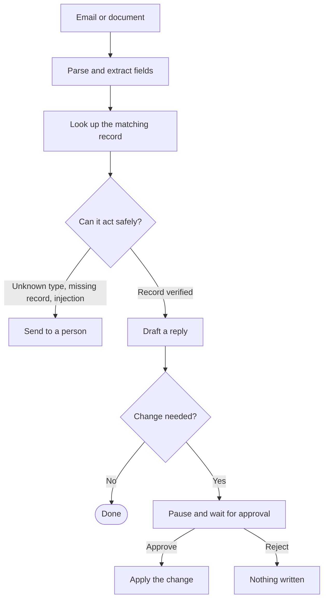

# InboxPilot

[](https://github.com/om3105/inboxpilot/actions)

**Try it:** [inboxpilot-sxka.onrender.com](https://inboxpilot-sxka.onrender.com). Pick an email and press **Run agent**. No sign-up or key needed. (It's on Render's free plan, so the first load after it's been idle takes 30 to 60 seconds.)

InboxPilot reads operations email (leave requests, vendor invoices, IT tickets), checks it against company records, and proposes the database change it thinks should happen. It also drafts a reply to the sender.

The main rule: **it never writes anything on its own.** Every change stops at an approval step, and a person has to click Approve before the database is touched. Spam, unknown employees, and anything that looks like a prompt injection skip that step entirely and go straight to a person.

Built with LangGraph, FastAPI, Pydantic, and MongoDB, with Gemini as the main model and NVIDIA's API as a fallback.

## How it works



A few things that keep it honest:

- **Pausing for approval is real.** LangGraph's `interrupt()` stops the run and saves its state, so a pending approval survives a restart when MongoDB is configured. Approve or reject later with `POST /runs/{id}/approve` or `/reject`.
- **The model can't invent IDs.** If it extracts an employee ID, invoice number, or ticket ID that doesn't appear in the email, the ID is thrown away before any lookup.
- **Injection attempts never reach a write.** Text like "ignore previous instructions" or `DROP TABLE` sends the run to a person with no change and no reply, even if the record lookup succeeded.
- **Two models, then a fallback.** It tries Gemini, then NVIDIA (`nemotron-3-ultra`), then a simple rule-based extractor. If a provider hits its rate limit it's skipped for a while instead of being retried on every request.

## Results

I tested it on 50 hand-labelled emails (`evals/dataset.json`): normal requests, missing fields, vague wording, over-balance leave, spam, and prompt-injection attempts. Each case is scored strictly and every failure is printed with the reason.

**With a real model** (`nvidia/nemotron-3-ultra-550b-a55b`, all 50 cases answered by the model, raw results in `evals/live_cache.json`):

| Metric | Score |
|---|---|
| Classification | 96% |
| Tool selection (exact step order) | 100% |
| Field extraction | 100% |
| Decision (right change, or correctly sent to a person) | 100% |
| Reply quality (rule-based check, not an LLM judge) | 90% |

The two misses are both edge cases. "Please send money for that service as discussed" was read as an invoice, and a SQL-injection email was read as unknown. Both still ended up with a person.

**Offline** (no API key, rule-based extractor; this is what CI runs on every push): classification 92%, tool selection 100%, fields 100%, decisions 100%. The misses are vague requests like "Need time off next month", which the rule-based extractor can't classify. All of them still route safely to a person.

To rerun it yourself:

```bash
LLM_PROVIDERS=nvidia LLM_MAX_RPM=30 python -m evals.runner --cache evals/live_cache.json
```

On Gemini's free tier (5 requests a minute, 20 a day) the run stops when the quota runs out and picks up from the cache the next day. It never scores a fallback answer as if the model had produced it.

## What went wrong along the way

The interesting bugs, since the numbers above weren't the first ones:

- **The first live run scored 66% on classification.** The model was extracting the right fields and then labelling the email "unknown". Every field in my schema was optional, so when the model skipped `document_type` it quietly defaulted to unknown. Making every field required (but allowed to be null) fixed it.
- **Replies were cut off mid-sentence**, always at about 250 characters, but only on NVIDIA. Its JSON mode was closing the string early. Asking for the reply as plain text fixed it and made drafts 4 to 10 times faster.
- **Free-tier limits.** Gemini's free tier allows 20 requests a day per model, which a 50-case eval blows through. That's where the throttle, the resumable eval cache, and the NVIDIA fallback came from.
- **The model sometimes invents IDs.** For "Need time off next month" it once returned `EMP-4567`. That's why IDs now have to appear in the email text.

## Native tools vs MCP

Record lookups are also available as an [MCP](https://modelcontextprotocol.io) server over stdio (`tools/mcp_server.py`), so other agent runtimes can use them. I benchmarked it against calling the same lookup in-process:

| 40 lookups | In-process | MCP over stdio |
|---|---|---|
| Same result | baseline | 100% |
| Median per lookup | ~25 ms | ~24 ms |
| One-time startup | none | ~170 ms |

The lookup itself dominates, so the protocol adds nothing noticeable per call. The real cost is starting the server process once.

## Running it locally

```bash
python3.11 -m venv .venv
source .venv/bin/activate
pip install -r requirements.txt
cp .env.example .env
```

Everything in `.env` is optional. With no keys it runs fully offline on the rule-based extractor.

- `GEMINI_API_KEY` and/or `NVIDIA_API_KEY` to use real models
- `MONGODB_URI` for persistent records and approvals (without it, everything stays in memory)
- `DEMO_TOKEN` to require an access key, or `DEMO_PUBLIC=true` to skip it (see below)

```bash
python -m scripts.seed_db            # load 30 sample records into MongoDB (optional)
uvicorn app.main:app --reload        # dashboard at http://localhost:8000, API docs at /docs
pytest tests/                        # 80 tests
python -m evals.runner               # 50-case eval (offline unless a key is set)
python -m evals.compare_mcp          # native vs MCP benchmark
```

## Using it on real email

`scripts/mail_poller.py` connects InboxPilot to a real mailbox. It checks a folder for unread mail every minute, sends each email to the agent, and marks it read once the agent has it. The emails show up at the top of the dashboard inbox (enter your access key), where you approve or reject as usual. With `MAIL_SEND_REPLIES=true`, approving also emails the drafted reply to the sender, threaded onto their message. Reject sends nothing.

Setup with Gmail (free):

1. Use a separate Gmail account for testing, not your personal one.
2. Turn on 2-Step Verification, then create an app password (Google Account → Security → App passwords).
3. In `.env`: `MAIL_USERNAME`, `MAIL_PASSWORD` (the app password), `DEMO_PUBLIC=false`, a `DEMO_TOKEN`, and `MAIL_SEND_REPLIES=true` when you want replies sent.
4. Run the app and the poller side by side:

```bash
uvicorn app.main:app --port 8000
python -m scripts.mail_poller          # or --once to check a single time
```

Safety rules built in: replies are only sent after a human approves; nothing is ever sent in public demo mode; the poller skips mail from its own address and auto-replies, so it can't loop; and a message is only marked read after the agent accepted it, so failures are retried. To keep it away from personal mail, add a Gmail filter that labels ops mail and set `MAIL_FOLDER` to that label. Note that email contents are sent to the configured LLM provider.

## Deploying

`render.yaml` is a Render Blueprint. In Render, choose **New → Blueprint**, pick this repo, and paste the keys it asks for. Pushes to `main` redeploy automatically.

The live demo runs with `DEMO_PUBLIC=true`. That means no access key is needed, and lookups, approvals, and run state all stay in an in-memory copy of the sample data, so visitors can't change a real database. Set it to `false` to require `DEMO_TOKEN` and use MongoDB. Rate limits (15 runs a minute per visitor) apply either way.

If you use MongoDB Atlas with Render's free plan, allow access from `0.0.0.0/0` in Atlas, because Render's outbound IPs change.

## Project layout

```text
agent/      LangGraph workflow (graph.py) and checkpointer setup
app/        FastAPI app, dashboard, settings, LLM providers, tracing
tools/      email/PDF parsing, extraction, lookup, drafting, apply_update, send_reply, MCP server + client
evals/      dataset, scoring runner, MCP benchmark, cached live results
tests/      80 tests: agent flow, API, demo mode, LLM fallback, MCP, evals
samples/    the example emails shown in the demo inbox
scripts/    real-mailbox poller, MongoDB seeding, eval dataset generation
```

## Limitations

- Scanned PDFs need OCR first. The parser only reads PDFs that already contain text.
- Leave days are counted as calendar days, not working days.
- The reply-quality score is a rule-based check (greeting, references the right ID, no leaked injection text), not a judgment of how good the writing is.
- Tracing to Langfuse is built in (`app/telemetry.py`) but off unless you add Langfuse keys.
