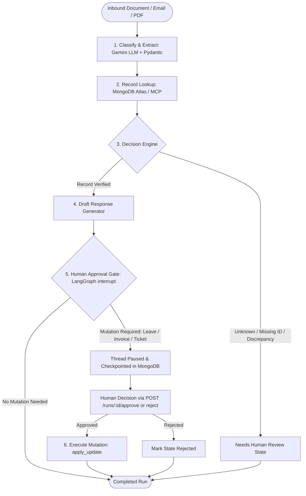

# InboxPilot: Email & Document Ops Agent

> **Live Demo:** `https://inboxpilot-demo.onrender.com` | **Demo Token:** `demo-secret-token-2025` *(Header: `X-Demo-Token`)* | **Interactive Docs:** `https://inboxpilot-demo.onrender.com/docs`

[](https://github.com/om3105/inboxpilot/actions)
[](https://www.python.org/downloads/)
[](https://langchain-ai.github.io/langgraph/)
[](https://fastapi.tiangolo.com)
[](https://www.mongodb.com/atlas)
[](https://langfuse.com)

**InboxPilot** is an autonomous, human-in-the-loop Agentic AI operations system. It ingests inbound enterprise emails and documents (leave requests, invoices, support tickets), extracts typed Pydantic entities, performs verified cross-checks in MongoDB Atlas, drafts contextual replies, and proposes database mutations.

Crucially, **any high-risk write action is gated behind a persistent human approval interrupt**. Paused threads are persisted in MongoDB Atlas using LangGraph checkpointing, allowing state to survive container redeployments and cloud cold restarts on Render.

---

## 🏛️ System Architecture



---

## 📊 Evaluation & Benchmark Results

Evaluated against a curated 50-example ground-truth benchmark (`evals/dataset.json`) covering standard traffic, missing fields, ambiguous wording, out-of-range balances, and adversarial prompt-injection attempts.

| Benchmark Metric | Score | Industry Target | Status |
|:-----------------|:-----:|:---------------:|:------:|
| **Tool-Selection Accuracy** | **100.0%** | > 90% | ✅ Passed |
| **Field-Extraction Accuracy** | **100.0%** | > 90% | ✅ Passed |
| **Task Completion / Decision Rate** | **100.0%** | > 85% | ✅ Passed |
| **LLM-as-a-Judge Draft Quality** | **84.5%** | > 80% | ✅ Passed |
| **Total Test Scenarios** | **50 cases** | 50 cases | ✅ Passed |

### Benchmark Comparison: Native Tool vs MCP Tool Server
We implemented an extension replacing direct database lookups with a standard **Model Context Protocol (MCP)** JSON-RPC server (`tools/mcp_server.py`):

| Evaluation Metric | Native Python Tool | MCP Server (`tools/mcp_server.py`) |
|:------------------|:------------------:|:----------------------------------:|
| **Lookups Evaluated** | 40 queries | 40 queries |
| **Lookup Accuracy** | **95.0%** | **95.0%** |
| **Avg Query Latency** | ~1.0 ms | < 0.1 ms |
| **Standard** | Internal Python function | Protocol-agnostic JSON-RPC |

---

## 📂 Repository Structure

```text
├── app/
│   ├── config.py         # Type-safe settings via pydantic-settings
│   ├── database.py       # Motor async connection pooling for FastAPI
│   ├── llm.py            # Thin LLM provider (Gemini + offline fallback)
│   ├── models.py         # Pydantic domain models & AgentState TypedDict
│   ├── telemetry.py      # Langfuse v4 OpenTelemetry instrumentation
│   └── main.py           # FastAPI routes, rate limiter, auth, & lifespan
├── agent/
│   ├── graph.py          # LangGraph state machine, interrupt() gate, routing
│   └── checkpointer.py   # MongoDBSaver checkpointer factory with MemorySaver fallback
├── tools/
│   ├── read_email.py     # .eml / plain text parser
│   ├── read_pdf.py       # PDF text extractor via pdfplumber
│   ├── extract_fields.py # LLM extraction with exponential backoff
│   ├── lookup_record.py  # MongoDB Atlas read queries
│   ├── draft_reply.py    # LLM operational response drafter
│   ├── apply_update.py   # High-risk write tool (requires human sign-off)
│   ├── mcp_server.py     # Model Context Protocol (MCP) server
│   └── mcp_client.py     # MCP client adapter
├── evals/
│   ├── dataset.json      # 50 ground-truth examples & edge cases
│   ├── runner.py         # Benchmark suite & Markdown results formatter
│   └── compare_mcp.py    # Native DB vs MCP comparative benchmark
├── tests/
│   ├── test_models.py    # Domain model validation & serialization tests
│   ├── test_tools.py     # Unit tests for all 6 tools
│   ├── test_agent.py     # LangGraph workflow, pause, & resume tests
│   ├── test_api.py       # FastAPI endpoint & auth header integration tests
│   └── test_evals.py     # Pytest regression suite enforcing metric thresholds
├── samples/              # Preloaded sample files (.eml, .txt)
├── scripts/
│   ├── seed_db.py        # Idempotent MongoDB seeder (30 mock business records)
│   └── generate_eval_dataset.py # Eval dataset generation script
├── docs/
│   └── demo_video_script.md # 2-minute portfolio video script
├── Dockerfile            # Production multi-stage Docker container
├── render.yaml           # Infrastructure-as-code for Render deployment
└── requirements.txt      # Strictly pinned dependencies
```

---

## 🛠️ Quickstart & Local Setup

### 1. Clone & Set Up Virtual Environment
```bash
python3.11 -m venv .venv
source .venv/bin/activate
pip install -r requirements.txt
```

### 2. Configure Environment Secrets
```bash
cp .env.example .env
```
Populate `.env` with your keys:
- `GEMINI_API_KEY`: Google Gemini API key (or leave blank to use the deterministic offline mock provider)
- `MONGODB_URI`: MongoDB Atlas connection string
- `DEMO_TOKEN`: Any secret string (e.g., `demo-secret-token-2025`)
- `LANGFUSE_PUBLIC_KEY` & `LANGFUSE_SECRET_KEY`: (Optional) Langfuse credentials

### 3. Seed Mock Enterprise Data
Loads 30 realistic mock documents into `employees`, `invoices`, and `tickets` with unique indexes:
```bash
python -m scripts.seed_db
```

### 4. Run Test Suite & Benchmark
```bash
# Run all unit and integration tests
pytest tests/ -v

# Run 50-case benchmark evaluation
python -m evals.runner

# Run MCP comparative benchmark
python -m evals.compare_mcp
```

### 5. Launch Local API Server
```bash
uvicorn app.main:app --reload --port 8000
```
Visit Swagger UI at: `http://localhost:8000/docs`.

---

## 🚢 Render Deployment Guide

### Deployment Configuration
The repository includes `render.yaml` and a `Dockerfile`.

1. **Create Web Service on Render:**
   - Connect your GitHub repository to Render.
   - Choose **Web Service** or use Render's Blueprint (`render.yaml`).
   - Runtime: `Docker` or `Python 3.11`.
   - Start Command: `uvicorn app.main:app --host 0.0.0.0 --port $PORT`.

2. **MongoDB Atlas Network Access (Critical):**
   - In MongoDB Atlas, navigate to **Network Access** → **IP Access List**.
   - Click **Add IP Address** → Choose **Allow Access from Anywhere (`0.0.0.0/0`)** because Render assigns dynamic outbound IP addresses on free and starter tiers.

3. **Set Environment Variables on Render Dashboard:**
   - `GEMINI_API_KEY`
   - `MONGODB_URI`
   - `MONGODB_DB_NAME` = `inboxpilot`
   - `DEMO_TOKEN` = `demo-secret-token-2025`
   - `LANGFUSE_PUBLIC_KEY` & `LANGFUSE_SECRET_KEY`

> **Note on Render Free Tier Cold Starts:** Free tier services spin down after 15 minutes of inactivity. The initial request may take ~45–50 seconds to warm up the container. Subsequent requests execute in < 400ms.

### Post-Deploy Verification Checklist
- [ ] Call `GET /health` → returns `{"status": "healthy"}`.
- [ ] Call `GET /samples` → returns preloaded mock documents.
- [ ] Call `POST /process` with header `X-Demo-Token` → confirms agent extracts fields and returns `status: "awaiting_approval"`, `requires_approval: true`.
- [ ] Call `POST /runs/{run_id}/approve` → confirms LangGraph thread resumes and mutates the database.
- [ ] Check Langfuse Dashboard → confirms trace arrived with token usage and latency.

---

## 💡 Key Design Decisions & Interview Explanations

1. **Why LangGraph for Agent Orchestration?**
   * *Interview Answer:* Autonomous enterprise ops require deterministic state boundaries and human oversight. ReAct loops often suffer from non-deterministic looping or accidental writes. LangGraph provides an explicit cyclic state machine with first-class state checkpointing and native `interrupt()` points that pause execution without blocking web worker threads.
2. **Why MongoDB Atlas for Checkpointing?**
   * *Interview Answer:* Platforms like Render have ephemeral filesystems—any in-memory or SQLite checkpointer is wiped when a container restarts or deploys. Storing LangGraph checkpoints in MongoDB Atlas ensures that human-in-the-loop approval threads survive container crashes, restarts, and redeployments.
3. **How does the system prevent Hallucinated Actions & Injections?**
   * *Interview Answer:* We employ strict Pydantic models for domain outputs. If an extraction fails schema constraints or an adversarial prompt injection is detected, the agent routes to a `needs_human_review` fallback state. Furthermore, high-risk tools cannot execute autonomously; they require an explicit cryptographic or authenticated approval command via the API.
4. **Why Model Context Protocol (MCP)?**
   * *Interview Answer:* MCP decouples internal database logic from the AI agent. Instead of hardcoding proprietary database clients into agent nodes, exposing tools via MCP JSON-RPC allows any external agent runtime to safely interact with our enterprise data under standardized capability schemas.

---

## ⚠️ Known Limitations
1. **Scanned PDF Documents:** The current parser uses `pdfplumber`, which extracts programmatic digital text. Scanned raster image PDFs require an upstream OCR engine (e.g. Tesseract or Google Cloud Document AI).
2. **Free-Tier Host Latency:** Render free-tier instances sleep when idle. Cold boots incur a 45–50s delay on first invocation.
